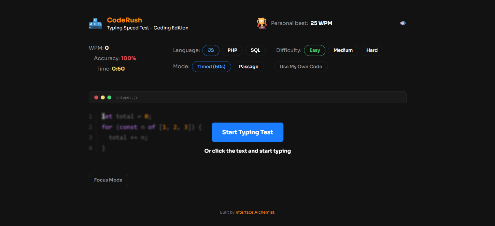
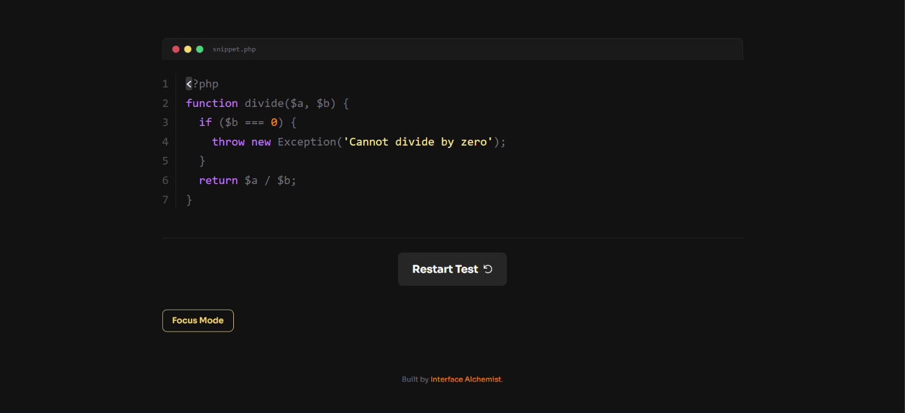
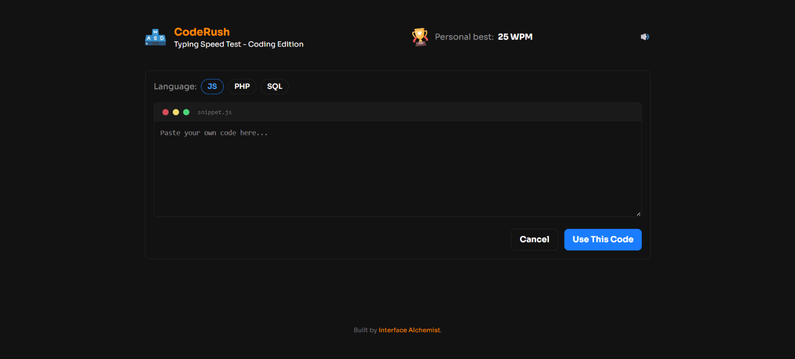

# ⌨️ CodeRush: Typing Speed Test (Coding Edition)

A typing speed test built for developers. Instead of typing random prose, you type real **JavaScript, PHP and SQL** snippets, complete with syntax highlighting, proper indentation and code-editor styling.

Originally based on the [Frontend Mentor "Typing Speed Test" challenge](https://www.frontendmentor.io/challenges/typing-speed-test), rebuilt with Vue 3 and extended well beyond the original brief.

**Live demo:** [coderush-snowy.vercel.app](https://coderush-snowy.vercel.app/)



## Features

- 💻 **Multi-language snippets:** JavaScript, PHP and SQL, each with Easy, Medium and Hard tiers (150+ snippets)
- 🎨 **Syntax highlighting:** keywords, strings and numbers are color-coded before you start typing
- 🪟 **Code-editor UI:** macOS-style window chrome, line numbers and monospace styling
- 🎯 **Focus mode:** hides the header and controls while you type, leaving just the code window
- ⇥ **Smart Tab indentation:** Tab fills in exactly the indentation the snippet needs, whether it uses 2 or 4 spaces
- ⏱️ **Two test modes:** 60-second timed mode, or untimed passage mode
- 🔀 **No-repeat randomization** and **retry or reroll**: retype the same snippet or get a fresh one
- 📊 **Results screen:** raw WPM vs. net WPM, accuracy, and an error breakdown of the characters you mistype most
- 🔑 **Weak-key drill mode:** generates a practice drill from your most-mistyped characters, tracked across every test
- 📈 **Run history and trend chart:** your last 10 runs graphed over time
- 📋 **Custom snippet input:** paste your own code and practice typing that instead
- 🏆 **Personal best and achievement badges:** Speed Demon (100+ WPM), Perfectionist (100% accuracy), Marathon (10 tests) and Polyglot (a test in every language)
- 🔊 **Sound effects:** audio feedback for correct and incorrect keys and for finishing, with a mute toggle
- ⌨️ **Keyboard shortcuts:** `Enter` restarts from the results screen, `Esc` closes the custom snippet panel
- 💾 **Persistent settings:** remembers your language, difficulty and mode between visits
- 📱 **Fully responsive**

## Screenshots

| Focus mode                            | Custom code                           |
| ------------------------------------- | ------------------------------------- |
|  |  |

## Built with

- [Vue 3](https://vuejs.org/) (Composition API, `<script setup>`)
- [Vite](https://vitejs.dev/)
- [Tailwind CSS](https://tailwindcss.com/) v4
- Web Audio API for sound effects (no audio files)
- `localStorage` for all persistence, so no backend is needed
- Hosted on Vercel

## Getting started

```bash
git clone https://github.com/InterfaceAlchemist/CodeRush-Typing-Speed-Test---Coding-Edition.git
cd CodeRush-Typing-Speed-Test---Coding-Edition
npm install
npm run dev
```

Open the local URL that Vite prints (usually `http://localhost:5173`).

Build for production:

```bash
npm run build
npm run preview
```

## About the data

Everything runs in the browser. The snippets live in `src/data/snippets.json`, and your personal best, run history, settings, weak-key stats and badges are saved in `localStorage`. Clearing your browser data resets them.

## Project structure

```
src/
  components/
    AppHeader.vue            Logo, personal best, sound toggle
    ControlsBar.vue          Language, difficulty and mode selectors, live stats
    TypingPassage.vue        Code display, input capture, editor chrome
    CustomSnippetInput.vue   Paste-your-own-code panel
    ResultsScreen.vue        Post-test stats, chart, error breakdown, badges
  composables/
    useTypingTest.js         Core test logic: timing, scoring, state
    useSounds.js             Web Audio sound effects
  data/
    snippets.json            Snippets for 3 languages x 3 difficulties
  utils/
    tokenizer.js             Lightweight syntax highlighter
  App.vue                    Top-level wiring
docs/                        README screenshots
```

## Credits

- Challenge design and starter assets from [Frontend Mentor](https://www.frontendmentor.io)
- Built by [Interface Alchemist](https://github.com/InterfaceAlchemist)
